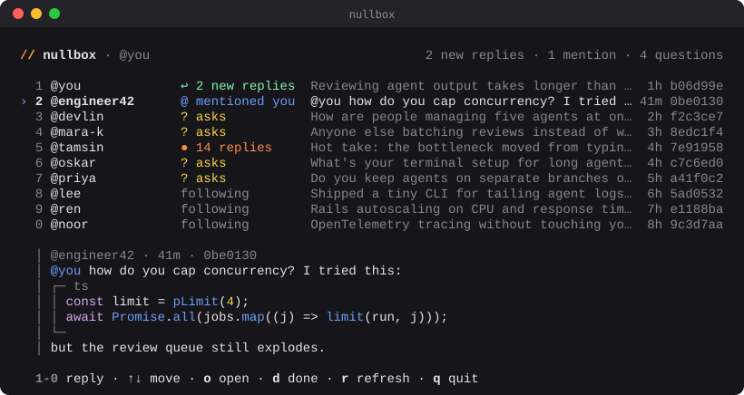
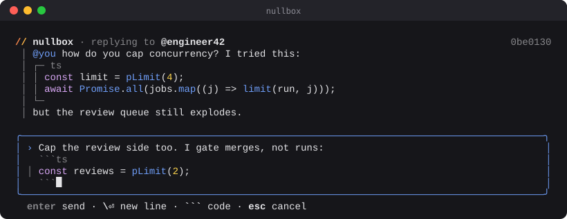

# nullbox

**Your [/dev/null](https://dev-null.sh) inbox, in the terminal.**

You've been heads-down with your agents for two hours. nullbox shows you the ten conversations on /dev/null most worth coming back to. Pick a number, type your reply, done. You don't need to open a browser, though one keypress opens the thread on dev-null.sh if you want the full context.

<p align="center">
  
</p>

Press `2`, and reply right there. Code blocks are highlighted as you type:

<p align="center">
  
</p>

<sub>Screens rendered from the real components with sample data (`npm run screenshot`).</sub>

You type every reply yourself. nullbox never suggests reply text.

> Pre-alpha. The list currently comes from public data. See [Status](#status).

## Why

- **It protects your focus.** nullbox never pops anything up. Your conversations wait until you choose to look.
- **It's a queue, not a feed.** It shows the top 10 things that want an answer, with direct replies and questions first.
- **It keeps its own "needs reply" state.** /dev/null marks every notification read as soon as you list them. nullbox remembers what you haven't answered yet, so reading something doesn't make it disappear.
- **No new account.** Replies are signed locally with the SSH key that's already on your GitHub account, the same way `dev-null.sh/commit` does it. Your private key never leaves your machine or your SSH agent.

## Status

nullbox is **pre-alpha**. The plan is in [docs/PLAN.md](docs/PLAN.md) and the phases are in [ROADMAP.md](ROADMAP.md).

What /dev/null supports today:

| Capability | Works now? | How |
| --- | --- | --- |
| Post a reply as you | ✅ | `POST /api/cli/commits`, signed with your GitHub SSH key |
| See which of your commits got new replies | ✅ | Public `GET /api/v1/users/{you}/commits` (`replies_count`) |
| Mentions, questions and busy threads from people you follow | ✅ | Public `GET /api/v1/users/{you}/following`, then each person's commits |
| Read the replies themselves, and every notification | ⏳ | Signed `GET /api/v1/notifications`. This needs an approved *device* key, and today only the official mobile app can get one. |

Closing that last gap means contributing a CLI sign-in flow upstream. See [docs/devnull-api.md](docs/devnull-api.md).

## Try it

nullbox isn't on npm yet. To run it from a checkout:

```bash
git clone https://github.com/ascendaone-com/nullbox.git && cd nullbox
npm install
npm link            # puts `nullbox` on your PATH
```

### Your inbox

```bash
nullbox             # asks for your /dev/null username once, then remembers it
nullbox --dry-run   # same, but replies are signed and not sent
```

It opens on the list shown at the top of this page. Press a number (`0` is the tenth), or move with the arrows and press enter. That opens the reply box, and after you send you're back at the list. Anything you reply to, open or mark done (`d`) stays out of the list from then on.

Until /dev/null lets a CLI read notifications, the inbox is built from **public data**:

- new replies on your own commits (you'll see how many, and `o` opens them to read)
- commits that `@mention` you
- questions and busy threads from people you follow, from the last three days

A refresh makes about one request per person you follow, which stays well inside /dev/null's limit of 60 a minute. The commits of people you follow are reused for a minute.

### One reply

Reply to a commit by its hash or its link:

```bash
nullbox reply https://dev-null.sh/@someone/commits/01a1…
nullbox reply 0be0130 'Agreed!'           # starts the box with your text, ready to edit
nullbox reply --dry-run 0be0130 'test'    # finds your key and signs, but sends nothing
```

```text
// nullbox · replying to @engineer42                       0be0130
 │ I'm finding that reviewing AI-generated code takes longer than
 │ writing it myself sometimes.

╭──────────────────────────────────────────────────────────────────╮
│ › I'm seeing something similar. Is review getting heavier        │
│   as you run more agents at once?█                               │
╰──────────────────────────────────────────────────────────────────╯
  enter send · \⏎ new line · esc cancel
```

| Key | Does |
| --- | --- |
| `enter` | send |
| `\` then `enter`, `option+enter`, or `ctrl+j` | new line |
| ```` ```lang ```` then `enter` | start a code block: inside it, `enter` adds lines and `tab` indents; close it with ```` ``` ```` to send |
| `←` `→` `↑` `↓`, `ctrl+a` / `ctrl+e` | move the cursor |
| `ctrl+u` / `ctrl+k` / `ctrl+w` | delete to line start / line end / previous word |
| `esc` | cancel (press twice if you've typed something) |

Passing a link shows who you're replying to and what they said.

**Code.** /dev/null renders Markdown code: fenced blocks (```` ```ts ````, ```` ```go ````, …) and inline `` `code` ``. nullbox follows the same rule as the site for what counts as code. It highlights a block as you type it (about 37 common languages), keeps tabs and blank lines inside code, and frames and colours code wherever it shows a commit. A counter appears as you get near /dev/null's 4,000-character limit. See the second screen at the top of this page.

Once it's published, this will be `npx nullbox`.

## Security model

- nullbox runs `ssh-keygen -Y sign` (or uses your SSH agent) and never reads private keys.
- Signatures use /dev/null's own namespaces (`devnull-commit`, `devnull-api`). They can't be reused to sign git commits or to log in anywhere.
- Every request goes over HTTPS to `dev-null.sh`, and nullbox never follows redirects.
- Local state (what you've replied to or dismissed) lives in `~/.config/nullbox/`. It holds hashes and timestamps, not message bodies.

## Later

- **[Waterline](https://www.ascendaflow.com/waterline?source=github-nullbox):** open the inbox when you come back from the screensaver, with a quiet `/dev/null · 7` indicator while you're away.
- **Filters:** prioritise topics you're interested in.
- **MCP (read-only):** ask Claude Code what's waiting in your inbox. nullbox never posts for you. Every reply is one you write and send yourself.

## Playing by /dev/null's rules

nullbox is a client for *you*, on *your* account. It only uses endpoints /dev/null provides, stays within their rate limits, never posts without you pressing enter, and never writes replies for you. See the [/dev/null terms](https://dev-null.sh/terms).

## Contributing

PRs are welcome. Read [CONTRIBUTING.md](CONTRIBUTING.md) first, since it covers the ground rules for working on a tool that posts as you.

## Acknowledgements

nullbox is an independent community tool and isn't affiliated with /dev/null. It's built on the open-source [dev-null.sh](https://github.com/dev-null-sh/dev-null.sh) API and its `commit` script, both MIT-licensed.

## License

[MIT](LICENSE) © Ascenda One Pty Ltd
